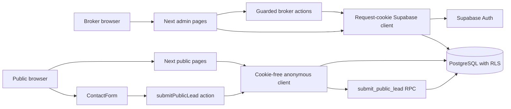
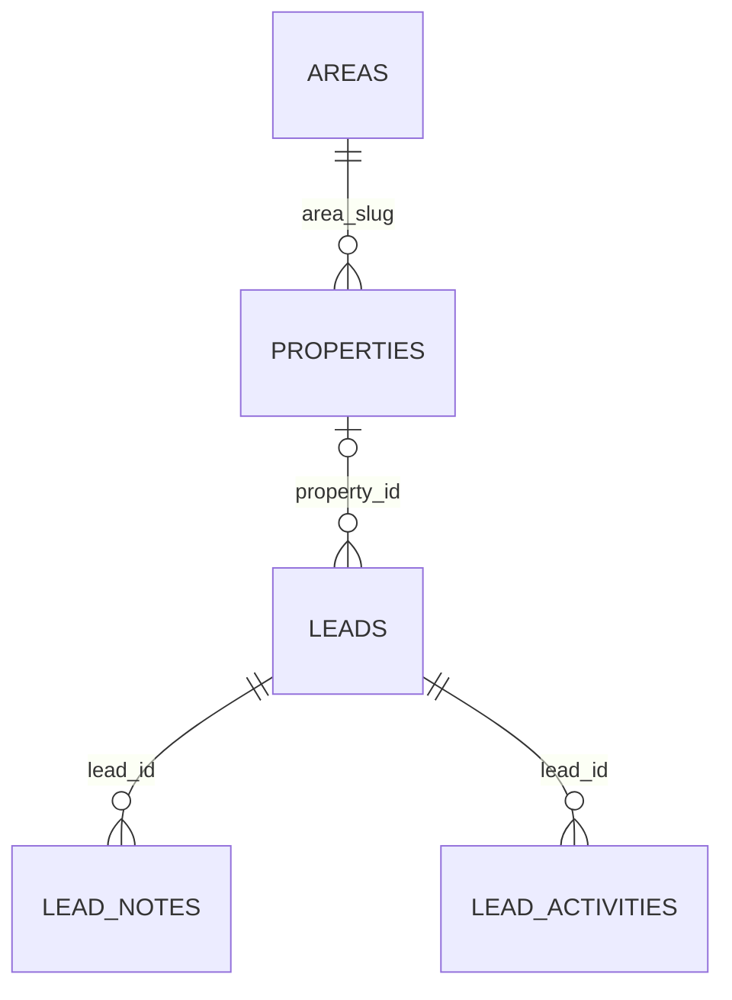
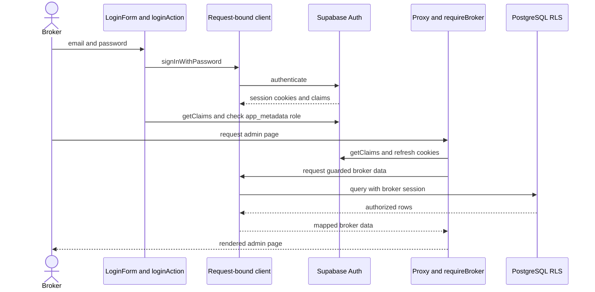
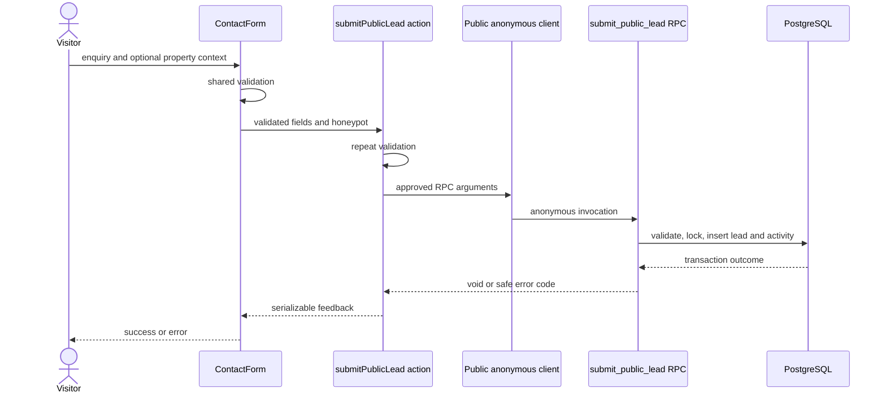
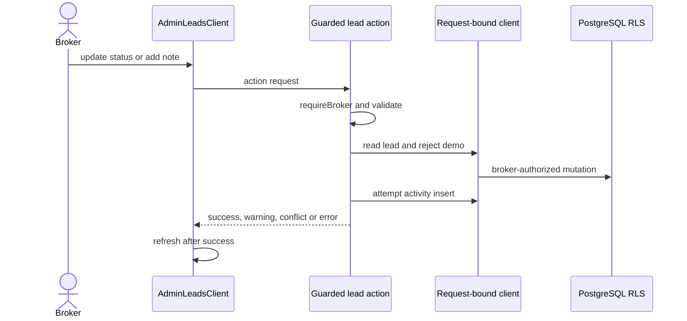

# Chennai Real Estates: technical overview

**Purpose:** engineering onboarding and maintenance reference. **Last verified:** 2026-11-09. **Baseline:** `2ab5949a14fdce5aebaf2766af376cc77ea4c836` on `main`.

This documents checked-in source and SQL, not the state of a deployed database. Source code and migrations are authoritative; update this guide when architecture, schema, authorization, security, or major workflows change. The discarded phone-rate-limit experiment is not implemented.

## 1. Project introduction

This is a single-broker property platform centered on Madipakkam and nearby Chennai areas. Visitors browse listings and locality guides, then contact the broker. The intended journey is visitor → catalogue → detail → enquiry → broker inbox → customer contact → site visit → follow-up. The application records enquiries and status; scheduling, verification, and transactions still require people.

A **listing** advertises a property; **resale** means an existing property being sold, rather than a separate database transaction type. **Lease** is one of sale/rent/lease; exact financial terms require broker confirmation. **Brokerage** is the broker's fee, represented as independent free text and optional structured terms. A **lead** or **enquiry** is a potential customer request; a **site visit** is an offline event. Availability status, legal approval, and broker verification are separate concepts (§6).

Public catalogue and enquiries, broker authentication, dashboard, property management, area management, and lead management use Supabase. Image uploads, automated notifications, comprehensive bot protection, and verified production operations are not established here.

## 2. Technology stack

Versions are from `package.json`; `^` represents a supported range, with exact resolution in the lockfile.

| Technology | Version | Purpose / location |
|---|---|---|
| Next.js | 16.4.5 | App Router, server components/actions and proxy; `src/app`, `src/proxy.ts` |
| React / React DOM | 19.3.0 | UI rendering and client interaction |
| TypeScript | ^5 | Strict types, domain models, server/client contracts |
| Tailwind CSS | ^4 | Utilities and theme tokens; `src/app/globals.css` |
| Radix Slot / CVA / clsx / tailwind-merge | ^1.5.0 / ^0.7.1 / ^2.1.1 / ^3.7.0 | Local shadcn-compatible primitives in `src/components/ui` |
| Lucide React | ^1.69.0 | Icons |
| Supabase JS / SSR | ^2.119.0 / ^0.12.7 | Data, Auth and session clients |
| PostgreSQL / Supabase Auth | Not pinned | Schema, RLS, RPC and password authentication |
| ESLint | ^9 | Next and TypeScript checks |
| Node assert / VM / TypeScript | Node built-ins and installed TypeScript | Focused test harnesses in `tests/` |

There is no Zod, Supabase Storage integration, established browser E2E framework, or checked-in Vercel configuration. Next serves the frontend and server logic; Supabase provides database/Auth. WhatsApp links, if configured, navigate to an external service.

## 3. High-level system architecture



The public client is server-only and independent of visitor cookies. Broker reads/actions use the request-bound client plus `requireBroker()` and database RLS. The public form validates in the browser and Server Action; the anonymous RPC validates again and atomically creates a lead and initial activity. Client components manage interactions and receive only data intentionally passed to them; the authorized broker form receives private fields it needs.

## 4. Repository and folder structure

```text
src/
  app/(public)/             public pages, layouts and contact action
  app/admin/(dashboard)/    guarded admin pages, property and lead actions
  app/admin/login/          password login
  components/               admin, areas, common, forms, layout, property, ui
  config/                   branding and navigation
  hooks/                    hydration and scroll helpers
  lib/auth/                 broker authorization and redirect validation
  lib/supabase/             clients, projections, queries, mappers, validation
  lib/validation/           shared public lead validation
  modules/                  labels, filters, demo data and presentation helpers
  types/                    domain types
  proxy.ts                  admin route gate and session refresh
supabase/migrations/        ordered schema and RPC migrations
supabase/seed.sql           sample records
tests/                      Node harnesses and SQL verification
public/                     static assets, if present
```

Public routes depend on anonymous queries and shared presentation; broker routes depend on guarded broker queries/actions. Add data-access logic in `src/lib/supabase` and a forward migration, not in demo arrays. There are no checked-in `route.ts` API handlers. Route groups affect layout, not URL paths.

## 5. Application routing and page architecture

| Route | Purpose / access | Components / data source |
|---|---|---|
| `/` | Public homepage | Featured properties, active areas and public counts from anonymous queries |
| `/properties` | Public catalogue | `PropertyFiltersForm`, `PropertyGrid`; public properties and areas |
| `/properties/[slug]` | Public property detail | `PropertyGallery`, `ContactForm`, related listings; public queries |
| `/areas` | Public area directory | Area cards, search, public counts |
| `/areas/[slug]` | Public area guide | Active area, public properties, listing-type filter |
| `/contact` | Public enquiry | `ContactForm`, optional explicit property context |
| `/admin` | Admin redirect | Redirects to dashboard, subject to proxy |
| `/admin/login` | Public login | `LoginForm`, `loginAction`, Supabase Auth |
| `/admin/dashboard` | Broker overview | Supabase property and lead stats and recent records |
| `/admin/properties` | Broker listing | `AdminPropertiesClient`, broker property/area reads |
| `/admin/properties/new` | Broker create | `PropertyForm`, broker areas, create action |
| `/admin/properties/[id]/edit` | Broker edit | Broker reads, `PropertyForm`, update action |
| `/admin/leads` | Broker inbox | `AdminLeadsClient`, lead/property option reads, guarded actions |
| `/admin/areas` | Broker area management | `AdminAreasClient`, guarded area reads and actions |

Pages are Server Components by default; forms, controls, dialogs and responsive menus use Client Components. Public and admin layouts provide separate shells; root/group `loading.tsx`, `error.tsx`, and root `not-found.tsx` provide boundaries. Public detail pages resolve slugs via anonymous queries and call `notFound()` for missing or unavailable records; database errors throw. Metadata uses public title/summary. A loading boundary can stream before `notFound()`, so the not-found UI can be returned with HTTP 200; verify actual HTTP behavior before relying on it for SEO. The dashboard layout obtains identity for its shell; it is not an independent authorization boundary. Protected pages, broker DAL functions and actions apply broker guards in addition to the proxy.

## 6. Core business domain and data model

Source of truth: `supabase/migrations/20261107000000_initial_schema.sql`. `N` means nullable; other columns are `NOT NULL`. Defaults and constraints below are SQL-level. Database fields are snake_case; mappers produce camelCase domain objects.



### Areas

| Column | Type / default | Constraint or meaning |
|---|---|---|
| `slug` | text | PK; lowercase hyphenated slug |
| `name` | text | Trimmed length ≥3 |
| `pincode` | text | Six digits |
| `summary` | text | Trimmed length ≥10 |
| `description` | text | Trimmed length ≥20 |
| `highlights` | text[] default `{}` | Guide highlights |
| `parent_area` | text, N | Display text, not an FK |
| `is_active` | boolean default true | Controls anonymous area visibility |
| `created_at`, `updated_at` | timestamptz default `now()` | Update trigger on `updated_at` |

### Properties

| Column | Type / default | Constraint or meaning |
|---|---|---|
| `id` | text, sequence-generated | PK; `MAD-` business ID, nonblank |
| `slug` | text | Unique, lowercase hyphenated |
| `title`, `summary` | text | Trimmed lengths ≥5 / ≥10 |
| `description`, `public_description` | text[] | Separate private/public descriptions; private array cardinality ≥1 |
| `type` | property_type | Required category |
| `configuration` | property_configuration, N | Bedroom configuration |
| `listing_type` | listing_type | Transaction type |
| `status` | property_status default `draft` | Availability, independent of approval |
| `price` | numeric(14,2) | Positive |
| `price_negotiable` | boolean default false | Negotiability |
| `bedrooms`, `bathrooms` | smallint, N | Nonnegative |
| `built_up_area_sqft` | numeric(10,2), N | Positive when present |
| `carpet_area_sqft`, `uds_sqft` | numeric(10,2), N | Nonnegative; UDS is undivided share |
| `floor`, `parking` | text, N | Free text |
| `facing` | facing, N | Enum |
| `building_age_years`, `total_floors` | smallint, N | Nonnegative |
| `has_lift` | boolean, N | True, false or unknown |
| `furnishing` | furnishing_status, N | Enum |
| `approval_status` | approval_status, N | Sample verification cannot be approved |
| `brokerage` | text, N | Independent free-form fee |
| `brokerage_type`, `brokerage_value` | brokerage_type, N; numeric(14,2), N | Nonnegative value; required for fixed/percentage and null for `none` |
| `availability_note`, `landmark`, `address` | text, N | Address is private |
| `security_deposit` | numeric(14,2), N | Nonnegative |
| `last_verified_at` | date, N | Required for broker-confirmed verification |
| `area_slug` | text | FK `areas.slug`; update cascade, delete restrict |
| `locality` | text | Separate locality text |
| `features` | text[] default `{}` | Features |
| `is_featured` | boolean default false | Homepage selection |
| `verification_status` | verification_status default `sample` | Verification distinct from approval |
| `whatsapp_reference` | text, N | Private reference, never the permanent ID |
| `listed_at` | date | Required listing date |
| `updated_at` | date default current_date | Date trigger, not a timestamp |

### Leads, notes and activities

| Column | Type / default | Constraint or meaning |
|---|---|---|
| `leads.id` | text, sequence-generated | PK; `LEAD-` business ID, nonblank |
| `leads.name`, `phone`, `message` | text | Nonblank name/message; the table constraint checks that phone contains 10–15 digits after removing nondigits; it does not normalize the stored value |
| `leads.email` | text, N | Optional |
| `leads.property_id` | text, N | FK properties; update cascade, delete restrict |
| `leads.status` | lead_status default `new` | Pipeline state |
| `leads.source` | lead_source, N | RPC derives source |
| `leads.is_demo` | boolean default false | Seeded demo rows are application read-only |
| `leads.created_at`, `updated_at` | timestamptz default `now()` | Updated-at trigger |
| `lead_notes.id` | bigint generated identity | PK |
| `lead_notes.lead_id` | text | FK leads; delete cascade |
| `lead_notes.body` | text | Nonblank |
| `lead_notes.created_at` | timestamptz default `now()` | Note timestamp |
| `lead_activities.id` | text | PK, nonblank, caller supplies ID |
| `lead_activities.lead_id` | text | FK leads; delete cascade |
| `lead_activities.occurred_at` | timestamptz | Required timestamp |
| `lead_activities.label`, `detail` | text; detail N | Label nonblank |

`MAD-...` and `LEAD-...` are business IDs; Auth user IDs belong to Supabase Auth. There is no image table in these migrations.

### Enum data dictionary

| Enum | Values |
|---|---|
| `property_type` | `apartment`, `independent-house`, `villa`, `plot` |
| `property_configuration` | `1-rk`, `1-bhk`, `2-bhk`, `3-bhk`, `4-bhk` |
| `listing_type` | `sale`, `rent`, `lease` |
| `property_status` | `available`, `under-offer`, `sold`, `draft`, `unavailable`, `expired` |
| `facing` | `north`, `south`, `east`, `west`, `north-east`, `north-west`, `south-east`, `south-west` |
| `furnishing_status` | `unfurnished`, `semi-furnished`, `furnished` |
| `approval_status` | `approved`, `unapproved`, `not-applicable` |
| `brokerage_type` | `percentage`, `fixed`, `none` |
| `verification_status` | `sample`, `broker-confirmed` |
| `lead_status` | `new`, `contacted`, `visit-scheduled`, `negotiation`, `converted`, `closed-lost` |
| `lead_source` | `website-form`, `property-enquiry`, `whatsapp`, `phone` |

Indexes: `properties_area_slug_idx`, `properties_status_idx`, partial `properties_public_browse_idx`, partial `properties_public_featured_idx`, `properties_updated_at_idx`, partial `areas_active_idx`, `leads_status_idx`, `leads_created_at_idx`, `leads_property_id_idx`, `lead_notes_lead_created_idx`, `lead_activities_lead_occurred_idx`, and PK/unique indexes. Areas and leads use timestamp updated-at triggers; properties use a date trigger. Exact check names and RLS policies are in the initial migration; access is summarized in §9.

## 7. Supabase integration architecture

| Module | Scope / key | Intended use |
|---|---|---|
| `src/lib/supabase/public-server.ts` | Server-only, publishable key, no cookies or session persistence/refresh/URL detection | Anonymous public reads and enquiry RPC; never broker private reads |
| `src/lib/supabase/server.ts` | Server-only, publishable key, request cookies | Login and guarded broker queries/actions; do not share across users |
| `src/lib/supabase/proxy.ts` | Server-only, publishable key, request/response cookies | Session refresh and cookie/header propagation |
| `src/lib/supabase/client.ts` | Browser SSR client, publishable key | Session-aware browser client where required |

No service-role client is present. Public row projections are in `database.types.ts`; broker projections are in `broker.types.ts`; mappers isolate database naming and nullability. Numeric database values may be strings or numbers. Domain conversions validate values; brokerage decimal strings preserve received precision where possible. JavaScript numbers have finite precision.

| Environment name | Purpose |
|---|---|
| `NEXT_PUBLIC_SUPABASE_URL` | Project URL; required when a client is created |
| `NEXT_PUBLIC_SUPABASE_PUBLISHABLE_KEY` | Publishable key; RLS remains the security boundary |
| `NEXT_PUBLIC_SITE_URL` | Metadata URL; defaults to local URL |
| `NEXT_PUBLIC_WHATSAPP_NUMBER` | Optional WhatsApp link configuration |

`src/lib/env.ts` validates Supabase values lazily and rejects `sb_secret_` keys. Configure local and hosting environments separately; public variables may be inlined at build time. Never put secret credentials in public variables.

## 8. Authentication and authorization



`loginAction` checks verified claims after password login, signs out non-brokers and sanitizes the `next` destination. `src/proxy.ts` leaves login public, checks other admin paths, refreshes cookies and redirects unauthorized users. `requireBroker()` calls `connection()`, uses React request-scoped `cache` and `getClaims()`, and trusts only server-controlled `app_metadata.role === "broker"`, not editable `user_metadata`. The dashboard layout obtains identity and provides shell context; protected pages, broker DAL functions and Server Actions apply their own guards. Database grants and broker RLS policies provide an additional database access boundary; their presence in migrations does not establish that they are applied in a deployed environment. `logoutAction` signs out. Hiding links in the browser is not authorization.

## 9. Database security and row-level security

All five tables have RLS. `public.is_broker()` is security-invoker, has an empty search path, and checks JWT `app_metadata.role`; authenticated users may execute it. Grants permit operations, policies restrict rows.

| Resource | Anonymous | Authenticated non-broker | Authenticated broker |
|---|---|---|---|
| Areas read | Active only | No matching policy | All |
| Properties read | `available` / `under-offer`, public columns only | No matching policy | All columns/statuses |
| Area/property writes | None | No matching policy | CRUD under broker policies |
| Lead/note/activity tables | No direct access | No matching policy | CRUD under broker policies |
| `submit_public_lead` | Execute | No execute grant | No authenticated execute grant; public client remains anon |

Authenticated table CRUD grants are constrained by broker policies with `USING` and `WITH CHECK`. Anonymous has no direct lead-table/sequence grants. Authenticated receives usage on property, lead and note sequences. The RPC is owned by `postgres`, `SECURITY DEFINER`, `RETURNS void`, has empty `search_path` and explicit execute grants/revokes.

Publicly granted property columns: `id`, `slug`, `title`, `summary`, `public_description`, `type`, `configuration`, `listing_type`, `status`, `price`, `price_negotiable`, `bedrooms`, `bathrooms`, `built_up_area_sqft`, `carpet_area_sqft`, `uds_sqft`, `floor`, `facing`, `building_age_years`, `has_lift`, `parking`, `furnishing`, `approval_status`, `brokerage`, `brokerage_type`, `brokerage_value`, `availability_note`, `landmark`, `total_floors`, `security_deposit`, `last_verified_at`, `area_slug`, `locality`, `features`, `is_featured`, `verification_status`, `listed_at`, `updated_at`. Private `description`, `address` and `whatsapp_reference` are omitted from grants and queries. `mapPublicProperty` maps `public_description` to domain `description`.

When changing RLS or grants, use a forward migration and test each anonymous, non-broker and broker role, including column-level permissions and direct RPC calls in a disposable environment. Never broaden private access merely to simplify a public query.

## 10. Public website workflows

### 10.1 Home

`src/app/(public)/page.tsx` uses `connection()` and parallel featured (limit three), public area and public property queries. Featured ordering is by ID. `withPublicPropertyCounts` counts returned public rows, not all inventory; four curated area slugs appear first, new areas follow by slug.

### 10.2 Catalogue

`/properties` fetches public rows and active areas server-side, parses URL parameters using `parsePropertyFilters`, then filters with `filterProperties`. Filters cover keyword, transaction, area, category, configuration, bedrooms, price and facing. Search uses public ID/title/summary/locality/area/landmark. There is no server-side pagination or full-text search; backend response limits may truncate large catalogues. `PropertyCard` links to the slug and `PropertyGrid` renders empty states.

### 10.3 Property detail

`getPublicPropertyBySlug` permits only available/under-offer records. The page retrieves the active area when available and same-area public listings. Related items exclude the current ID, prioritize the same property **type**, then sort updated date descending and ID ascending; maximum three. Gallery images are illustrations, not uploaded photographs. Enquiry context uses the permanent ID, not editable text or private WhatsApp reference.

### 10.4 Contact

`/contact` supports general and explicitly referenced property enquiries. An invalid supplied property reference must not silently become a general enquiry. Contact details in `src/config/site.ts` are placeholders; WhatsApp links are conditional on configuration.

### 10.5 Navigation and responsive behavior

Public layout uses header, footer and mobile navigation; admin uses `AdminShell`, sidebar, header and mobile navigation. Tailwind breakpoints switch grids, tables and cards. `next/link` drives navigation; catalogue filters use URL search parameters and server rendering. See §11 for the sensitive-form fallback.

## 11. Public enquiry submission: end-to-end



`ContactForm` and the Server Action validate name (trimmed 2–120), phone (trimmed formatted input ≤256 characters and 10–15 digits after normalization), optional email (blank→null, ≤254, basic shape), message (trimmed 10–4000), and optional property ID (≤64, explicitly blank rejected). `null` or omitted means general. The RPC independently trims its phone input, limits the trimmed formatted value to 64 characters, removes nondigits and validates 10–15 digits before storing it; it also validates property visibility. The action normally passes the application-normalized digits to the RPC. JavaScript string length and PostgreSQL character count can differ for Unicode.

The server-rendered form specifies fixed `POST /contact`, disables its button until hydration and explains the JavaScript requirement. Hydrated submission prevents default, validates, focuses the first invalid field, prevents concurrent clicks with a ref and pending state, and calls the action. Verify the actual no-JavaScript and implicit-Enter behavior before launch.

`public.submit_public_lead(p_name text, p_phone text, p_email text, p_message text, p_property_id text default null) returns void` is defined by the two later migrations. It derives source, `status='new'`, `is_demo=false`, IDs and timestamps. Invalid input uses `22023`; missing/nonpublic property uses `P0001`; a same-phone/same-property enquiry within 60 seconds uses `P0002`. An advisory transaction lock serializes that pair, and lead and initial activity inserts are atomic. The action returns safe serializable feedback, not IDs or raw errors. The website honeypot is not enforced for direct anonymous RPC calls. No durable per-phone/IP limit, CAPTCHA or configured WAF is implemented; direct invocation and rotating numbers remain risks.

## 12. Broker administration workflows

### Dashboard and areas

`/admin/dashboard` uses `getBrokerPropertyStats` for exact head-only counts of all, available, under-offer and sold properties, and `getRecentBrokerProperties` for up to five records ordered by `updated_at` descending then ID ascending. The date has day precision, so ID breaks same-day ties. The dashboard also uses `getBrokerLeadStats`, `getRecentBrokerLeads` and `getBrokerPropertyOptions`. Seeded sample properties have no demo marker and are included in counts. Errors propagate to the admin error boundary.

`/admin/areas` calls `getBrokerAreasWithCounts`, which reads explicit area columns in stable pages and obtains exact all-status and public-status counts per area. `saveBrokerArea` and `setBrokerAreaActive` validate server input, call `requireBroker()`, use the request-bound client and rely on broker RLS. The database unique constraint rejects duplicate slugs; slug changes cascade through the existing property foreign key. Actions revalidate affected public and admin paths and report refresh warnings. No area delete control exists. Public area access remains subject to existing RLS. No migration is added; applied environment state still needs verification.

### Properties

`getBrokerProperties`, `getBrokerPropertyById`, and `getBrokerAreas` use the request-bound client and guards. Broker area options include inactive areas to retain existing relations. List filters and search use current server props. Create/edit uses `adaptPropertyForm`, `validateBrokerPropertyInput`, and `mapBrokerPropertyCreate`/`mapBrokerPropertyUpdate`; a slug is generated and checked, while PostgreSQL generates the property ID. Partial updates preserve hidden fields, ID, slug, independent descriptions and unchanged free-form brokerage. `publish` sets `available`, `draft` sets `draft`, and `preserve` retains status. `updateBrokerPropertyStatus` supports all six statuses with confirmation for nonpublic targets; it does not alter approval.

Property actions revalidate the admin list/edit, home, catalogue, area list, property/area details and previous slug/area where applicable. Post-write invalidation failure returns a warning. Image selections are previews only.

### Leads

`/admin/leads` uses `getBrokerLeads`, `getBrokerPropertyOptions` and optional deep-link lookup. `AdminLeadsClient` provides filtering, detail, status, notes and activity. Seeded demo leads are labeled and guarded actions reject modifications based on the authoritative `is_demo` row. `updateBrokerLeadStatus` conditionally updates the previous status; `addBrokerLeadNote` validates nonblank text. Both attempt activity insertion separately and revalidate `/admin/leads` and `/admin/dashboard`. Broker actions are **not atomic** with their activity insert: a saved change can return an activity warning.



## 13. Data validation and error handling

Shared public validation is in `src/lib/validation/public-lead.ts`; the form and action invoke it, and PostgreSQL independently validates. Broker property validation is `src/lib/supabase/validation/broker-property-input.ts`; it checks enum values, decimal precision, dates, booleans, area references and verification/approval combinations. `property-form-adapter.ts` distinguishes omitted fields, intentional clears, false and zero. Broker lead actions validate IDs, statuses and note text.

Public single-record queries return `null` only for missing rows and throw on database errors. Actions return safe discriminated results; invalidation failure after a successful write is a warning, not a failed mutation. No broad demo fallback should mask live read errors. Client validation is convenience, not a security boundary.

## 14. State management, caching and performance

React state handles forms, filters, dialogs and pending state; server props remain authoritative for admin data. Actions use `revalidatePath`; lead updates and property status changes also call `router.refresh()`. Property create/edit forms show action feedback and rely on action invalidation and subsequent user navigation rather than calling `router.refresh()` themselves. `next.config.ts` enables Cache Components and partial prefetching. Several request-dependent pages set `instant = false`; auth uses `connection()` to avoid prerendering request-time token checks. Never cache a cookie-bound client or private rows across users.

Public queries have deterministic ordering but no application pagination and can be affected by backend response caps. Broker inbox is limited to the most recent 100 with an exact total and notice. Child rows and property options use 500-row pages and a 40-page safety ceiling. Filtering the inbox window is not global. Indexes are listed in §6. No Storage or persistent image-upload pipeline is configured; the browser-only preview uses Next Image for selected local files.

## 15. UI and design system

`src/app/globals.css` defines Tailwind v4 tokens for warm light surfaces, charcoal text, green accents and radii. `src/app/layout.tsx` uses Inter and Instrument Serif via `next/font/google`. Reuse `src/components/ui` buttons, cards, inputs, selects, badges, tables and textareas; `components/admin` provides `AdminModal`, `AdminDataTable`, badges, `ActionFeedback`, headers and stat cards; `components/common` provides notice, loading, error and empty states. Forms use `FormField`; icons come from Lucide. No toast library is configured.

## 16. Testing architecture

No Jest, Vitest, Playwright or Cypress framework is configured. `.cjs` tests use Node `assert`, VM, TypeScript transpilation, mocked clients/actions or static SQL inspection. These do not by themselves prove live database grants, cross-session locking, browser hydration or deployed configuration.

| Area | Test files | Command / coverage |
|---|---|---|
| Dashboard and areas | `tests/broker-dashboard-areas.test.cjs` | `node tests/broker-dashboard-areas.test.cjs`; mock reads, counts, ordering, authorization and writes |
| Public action / validation | `tests/public-lead-action.test.cjs` | `node tests/public-lead-action.test.cjs` |
| RPC static checks | `tests/public-lead-rpc.test.cjs` | `node tests/public-lead-rpc.test.cjs`; no SQL execution |
| Prehydration render | `tests/contact-prehydration.test.cjs` | `node tests/contact-prehydration.test.cjs` |
| Broker leads | `tests/lead-read.test.cjs`, `tests/lead-actions.test.cjs` | Run each with `node`; mocks and authorization |
| Broker property | `tests/property-actions.test.cjs`, `tests/property-form-adapter.test.cjs`, `tests/property-brokerage.test.cjs` | Run each with `node` |
| Property pages/list | `tests/property-pages.test.cjs`, `tests/property-list-refresh.test.cjs` | Run each with `node`; mocked rendering |
| SQL runtime | `tests/sql/public-lead-rpc.sql` | psql script for disposable local/staging; manual atomicity procedure included |

Add action tests with mocked guarded clients and failure cases, then separately test RPC security/atomicity in a disposable database and form behavior in a browser where the invariant depends on those systems.

## 17. Database migration and seed management

The initial migration creates schema/RLS; `20261109000000_public_lead_submission.sql` adds the RPC; `20261110000000_reject_blank_public_lead_property_id.sql` replaces it to reject blank references. Do not rewrite migrations already applied elsewhere. `supabase/seed.sql` contains four areas, nine sample properties and seven demo leads; it is not a production import strategy.

No `supabase/config.toml` or Supabase CLI package is checked in. Establish CLI and local-stack availability separately. The SQL test includes psql meta-commands and cannot be pasted unchanged into Dashboard SQL Editor. Adapt and review for a disposable environment; rollback test inserts can still consume sequence values. Never run tests against production.

Workflow: identify the intended project and migration state; create a later migration; review SQL, grants, RLS and data impact; test in disposable local/staging; verify roles, application behavior and migration history; obtain the normal production approval; apply only to the intended target; verify and commit. With a separately installed CLI, check its version and help for migration-list and dry-run commands before use. Remote linking and deployment are not established by this repository. Plan a forward fix and recovery; SQL migrations do not automatically undo data changes.

## 18. Local development setup (Windows PowerShell)

Install Git, npm and Node.js 22 or a later compatible version. The locked Supabase dependencies require Node.js 22 or later, even though Next.js has a lower minimum. Obtain the repository URL from the owner.

```powershell
git clone <repository-url>
Set-Location chennai-real-estates
npm ci
Copy-Item .env.example .env.local
# Configure the variable names in section 7 with your own nonproduction values.
npm run dev
```

Open `http://localhost:3000`. Use a dedicated local or staging Supabase project and broker account, never production data for tests. `getSupabasePublicConfig()` reports missing/malformed URL or key when a client is created; restart after changing values.

```powershell
npm run typecheck
npm run lint
npm run build
npm run start
node tests/public-lead-action.test.cjs
node tests/public-lead-rpc.test.cjs
```

Run other tests individually as listed in §16. `npm run start` serves an existing build. Google font fetching may require build-time network access.

## 19. Deployment architecture and environments

Git history and a remote named `origin` exist, but this repository does not establish a GitHub URL, Vercel project, production deployment, CI pipeline, project separation or hosting variables. Verify these with the owner. A build uses `npm run build`; hosting must configure the proper public Supabase variables and optional site/WhatsApp settings. Keep staging and production projects separate. Confirm the CLI target before any migration and use the team's verified release/rollback process.

## 20. Logging, monitoring, backups and operations

The public action maps errors to safe feedback and does not intentionally log enquiry PII. No application monitoring, alerting, backup schedule, retention policy, consent implementation or incident runbook is verified in the repository. Provider capabilities and actual settings require operator verification. Avoid logging request bodies or tokens; define retention and deletion procedures. Before launch, replace placeholder contact information, settle privacy/consent and retention, configure abuse protection for application and direct-RPC surfaces, and test backup restoration and migration recovery.

## 21. Engineering decisions and constraints

Calling the repository a modular monolith is an inference from its single Next application and domain modules, not a recorded strategic decision. Server Components keep public data reads on the server. The narrow RPC and anon column grants avoid direct anonymous lead insertion and private property exposure. Guarded actions and RLS protect direct calls; proxy checks alone are insufficient. Public and private descriptions remain independent. Permanent IDs differ from private WhatsApp references. Demo lead protection exists in broker actions as well as UI.

## 22. How to extend the application

1. **Public page:** add under `src/app/(public)`; reuse public queries/components; validate parameters, metadata, not-found/errors and public fields.
2. **Admin page:** add under `src/app/admin/(dashboard)`; use `requireBroker`, request-bound clients and RLS; add navigation after authorization.
3. **Property field:** inspect schema/migration, grants, public/broker projections, `database.types.ts`, `broker.types.ts`, mappers, validation, form adapter, UI and tests; classify privacy explicitly.
4. **Property filter:** change `src/modules/properties/filters.ts`, controls and tests; account for backend response limits.
5. **Lead field:** review schema/RLS, broker types/mappers/queries, public form and RPC if externally supplied, privacy and tests.
6. **Lead status:** add a forward enum migration; update `src/types/lead.ts`, `src/modules/leads/constants.ts`, actions, stats, UI and tests.
7. **Server Action:** validate all input, guard broker operations, use minimum projections, return safe serializable results and revalidate affected paths.
8. **Supabase RPC:** add a forward migration with constrained parameters, secure execution context, fixed search path and grants; test direct roles and transaction behavior.
9. **Database table:** define keys, checks, indexes, lifecycle, RLS and grants; add narrow typed DAL and tests before exposing it.
10. **RLS policy:** review grants and policies together; test allowed/denied roles and columns on disposable data.
11. **Validation rule:** update shared, server and database enforcement where appropriate; test null/omitted values, normalization, direct calls and UI focus.
12. **Property images:** currently absent. Design storage permissions, file limits, ownership, lifecycle and public exposure before adding a backend; previews are not persisted.
13. **Test:** extend existing `tests/*.test.cjs` harnesses and add real browser/database tests where needed.

## 23. Known limitations and technical debt

**Functional:** sample property rows are included in database counts; gallery images are illustrations; uploads are absent; public catalogue has no application pagination; broker inbox is windowed; contact configuration is placeholder.

**Security:** the honeypot and one-minute duplicate guard are not comprehensive rate limiting; direct anonymous RPC calls bypass the website honeypot. There is no implemented CAPTCHA or trusted per-IP protection. Duplicate responses can reveal limited recent-submission information. Verify JavaScript-disabled form and streamed HTTP status behavior.

**Operations:** deployment, migration state, backup/restore, monitoring, privacy notice, consent and retention are unverified. **Future enhancements:** image management, notifications, scalable search and broader browser/database automation need explicit design.

Documentation maintenance: for changes to architecture, features, workflows, routes, schema, security, integrations, validation, setup, tests, deployment, or limitations, review and update README.md and both guides in the same task as appropriate.

## 24. New engineer onboarding checklist

- [ ] Understand the single-broker journey and availability/approval/verification distinctions.
- [ ] Clone, configure a nonproduction environment and run §18 commands.
- [ ] Read the architecture and ER diagrams and all three migrations.
- [ ] Trace anonymous and request-cookie clients, broker claims, grants and RLS.
- [ ] Trace a public enquiry through the RPC and a broker lead update through its action.
- [ ] Run the focused tests and arrange browser and disposable database verification.
- [ ] Confirm staging, deployment and Git review practices with the owner.
- [ ] Update this guide when verified implementation details change.

## 25. Quick reference and glossary

| Topic | Location |
|---|---|
| Public / admin routes | `src/app/(public)/`, `src/app/admin/` |
| Supabase clients | `src/lib/supabase/public-server.ts`, `server.ts`, `client.ts`, `proxy.ts` |
| Broker authorization | `src/lib/auth/broker.ts`, `src/proxy.ts` |
| Public enquiry action | `src/app/(public)/contact/actions.ts` |
| Public enquiry RPC | `supabase/migrations/20261109000000_public_lead_submission.sql` and `supabase/migrations/20261110000000_reject_blank_public_lead_property_id.sql` |
| Database schema and RLS | `supabase/migrations/20261107000000_initial_schema.sql` |
| Queries and mappers | `src/lib/supabase/queries/`, `src/lib/supabase/mappers/` |
| Validation | `src/lib/validation/public-lead.ts`, `src/lib/supabase/validation/broker-property-input.ts` |
| Tests | `tests/`, `tests/sql/` |
| Environment variables | `src/lib/env.ts`, `src/config/site.ts`, `.env.example` |
| Commands | `package.json`: `dev`, `build`, `start`, `lint`, `typecheck` |

**Glossary:** RLS = PostgreSQL row-level security; RPC = callable database function; DAL = data access layer; UDS = undivided share; `anon` = Supabase anonymous database role; broker = authenticated user with server-controlled broker claim; demo lead = seeded record marked `is_demo` and made read-only by broker application actions.
