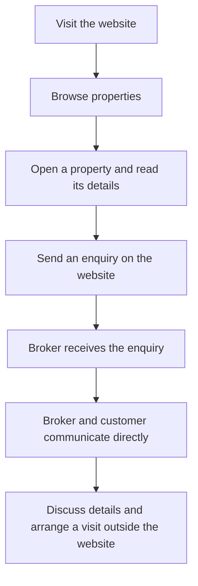
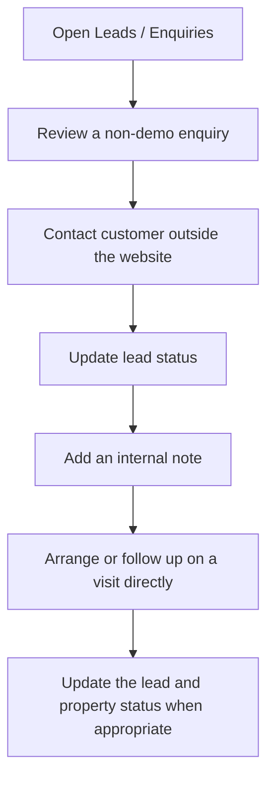

# Chennai Real Estates: website user guide

This guide is for people looking for property and for the broker who manages listings and enquiries. It reflects the website features checked on 9 November 2026. Screen details may change as the website develops.

**Important:** Property information, prices and availability can change. Confirm details with the broker before making a decision. An enquiry is not a booking, and the website does not automatically arrange a visit.

## Part A — Customer guide

### 1. What the website offers

Chennai Real Estates is a property catalogue and enquiry website for homes and other properties in and around Madipakkam. You can browse properties offered for sale, rent or lease, explore areas and ask the broker for information. The broker can help explain the listing and arrange the next conversation or visit with you directly.

You do not need an account to browse or send an enquiry. You may use the **Contact** page or a form on a property page. Phone and email contact details currently shown on the site are placeholders and need to be replaced before launch. A WhatsApp option appears only when it has been configured.

### 2. Exploring the home page

The main navigation contains **Home**, **Properties**, **Areas** and **Contact**. On a smaller screen, open the navigation menu to see the links.

The home page has a property search, a **Featured properties** section and **Popular localities**. Select **Explore Properties** to open the catalogue, or choose an area to explore its guide and listings. Choose **Contact** when you want to ask the broker a general question.

### 3. Browsing and searching properties

1. Select **Properties** in the navigation or **Explore Properties** on the home page.
2. Browse the property cards. A card can show the title, area, transaction type, price, status and available facts such as configuration or size.
3. Select a property to open its full details.
4. To narrow the list, enter or choose any of the filters below and select **Apply filters**. Select **Clear filters** to return to the wider list.

| Filter | What it means |
|---|---|
| **Locality or keyword** | Search using a place, property title, ID or a landmark mentioned in a listing. |
| **Transaction** | Choose sale, rent or lease. |
| **Locality** | Choose a listed area. |
| **Property category** | Choose apartment, independent house, villa or plot. |
| **Property type** | Choose a layout such as 1 RK or 2 BHK. |
| **Bedrooms** | Choose the number of bedrooms; **4+ bedrooms** includes four or more. |
| **Facing** | Choose a listed direction. Confirm what the direction refers to with the broker. |
| **Minimum price (₹)** / **Maximum price (₹)** | Set a price range. The amount is the listed sale price, monthly rent or lease amount, depending on the transaction. |

If no properties match, widen or clear the filters. There is no separate sorting control or page-by-page browsing control in the current catalogue. Availability should always be confirmed with the broker.

### Browsing areas

Select **Areas** in the navigation to browse the available neighbourhoods. Enter a locality name or pincode and select **Search areas**; use **Clear** to see all areas again. Select an area card to open its guide, highlights and public listings.

On the area page, choose a transaction type to show sale, rent or lease listings, or clear the selection to see all types. You can also open the full catalogue for that area. Select a property card to read its details and send an enquiry to the broker. Area property counts reflect public listings.

### 4. Understanding a property page

The details shown depend on what was supplied for that listing. A blank or missing item does not mean the answer is zero or that a feature is absent; ask the broker.

| Detail | Plain-English meaning |
|---|---|
| **Property ID** | The listing's permanent reference. Use it when asking the broker about the property. |
| **Property category** | Whether the listing is an apartment, house, villa or plot. |
| **Property type / configuration** | A layout such as **2 BHK**: two bedrooms, a hall and a kitchen. **1 RK** describes one room and a kitchen. |
| **For sale / rent / lease** | The kind of transaction offered. A lease is an arrangement under agreed terms and period; ask the broker about its payment and conditions. |
| **Price** | The listed sale price, monthly rent or lease amount. A negotiable note appears when supplied; confirm the current amount and terms. |
| **Area / locality** | The neighborhood named for the listing. |
| **Built-up area** | The stated constructed area, generally including walls; confirm the measurement. |
| **Carpet area** | The stated usable area within the property; ask how it was measured. |
| **UDS** | Undivided share of land associated with an apartment, when supplied. |
| **Bedrooms / bathrooms and floor** | The listed room counts and floor information. |
| **Facing** | A listed direction such as east or north; confirm whether it refers to the entrance or another part of the property. |
| **Furnishing, building age, lift and parking** | Details supplied about fittings, age and facilities. |
| **Features, description and landmark** | Additional information provided for visitors. |
| **Approval / verification** | An approval status may be shown, and sample listings are marked unverified. Check any approval warning and current details with the broker. |
| **Brokerage** | A broker's service fee for helping with a transaction, where terms are supplied. Confirm the amount and conditions. |
| **Status** | **Available** or **Under offer** can be displayed publicly. Both should be confirmed with the broker. |

Some listings can have an independent broker reference. That is different from the public property ID and is not shown as the public listing reference. Property images are currently illustrative; they are not a promise of photographs of the actual property.

### 5. Contacting the broker

Use **Contact** for a general enquiry. For a question about one listing, open the property and use its enquiry form; the property reference is attached to the enquiry. If a WhatsApp link is available, you can use it to open a message addressed to the configured number. Phone and email links depend on correct contact details being configured.

A general enquiry describes what you are looking for without selecting a particular property. A property enquiry identifies a listing as well as your message. You can enquire about more than one property by opening each relevant property and sending a separate enquiry. Rapid repeated submissions for the same property may be rejected; wait before trying again.

### 6. Sending an enquiry

1. Open **Contact** for a general question, or open a property and find its enquiry form.
2. Enter **Your name** and **Phone number**.
3. Enter **Email address** if you want to provide one; it is optional.
4. Under **What are you looking for?**, describe your needs or question. On a property page a starting message may already be filled in; you may edit it.
5. Select **Send enquiry** and wait while the button says **Sending…**.
6. Look for **Enquiry sent**. If you see an error, correct the highlighted fields or try again as explained below.

Your name must contain 2–120 characters after leading and trailing whitespace is trimmed. Your phone number must contain 10–15 digits; formatting characters are ignored. An optional email must have a valid email shape and be no longer than 254 characters. Your message must contain 10–4,000 characters after leading and trailing whitespace is trimmed. If the form asks you to check a field, follow the message beside it. JavaScript must be available for this form; if it does not become ready, use a configured contact method instead.

The broker receives the name, phone, optional email, message and, for a property enquiry, the selected property reference. An unavailable property may produce a message asking you to call the broker. A repeated enquiry may ask you to wait before trying again. Your entered information remains on the form after either success or failure; check the message before sending again. A successful submission does not guarantee an immediate response or a booking.

### 7. From searching to a visit

The website collects the enquiry; the broker and customer arrange any visit separately.

### 8. Customer questions

**Do I need an account?** No account is required to browse or enquire.

**How do I contact the broker?** Use the enquiry form, or a configured phone, email or WhatsApp option. Confirm that contact details have been set up before relying on them.

**Can I enquire about several properties?** Yes. Open each listing and send an enquiry for it. Wait if the website rejects a rapid duplicate.

**What happens next?** The enquiry is made available to the broker, who can contact you using the details supplied. No response time is guaranteed by the form.

**What if a listing is no longer available?** It may disappear from the catalogue or the form may report that it is unavailable. Ask the broker about alternatives.

**How do I identify a listing?** Give the broker its property ID and title.

**Is an enquiry a booking?** No. It does not reserve a property or schedule a visit.

**Is the price negotiable?** A listing may say so; confirm the amount and terms with the broker.

**What is brokerage?** It is a broker's service fee. Ask the broker to explain the applicable terms.

**Can I arrange a visit?** Discuss a suitable time directly with the broker; the website does not book it automatically.

## Part B — Broker and administrator guide

### 9. The broker dashboard

The admin area is for authorized broker accounts. It is separate from the public website and provides property and enquiry management. Its navigation includes **Dashboard**, **Properties**, **Add Property**, **Leads / Enquiries** and **Areas**.

The dashboard currently mixes live enquiry information and sample property information:

| Dashboard card | What it counts |
|---|---|
| **Total properties** | Sample property records, including drafts; not live inventory. |
| **Available** | Sample properties marked available. |
| **Under negotiation** | Sample properties marked under offer. |
| **Closed** | Sample properties marked sold/closed. |
| **New enquiries** | Enquiries marked New, including labeled demo enquiries. |
| **Pending enquiries** | Enquiries marked New, Contacted or Visit scheduled; it is not a count of every possible open status. |
| **Scheduled visits** | Enquiries marked Visit scheduled; this is not an automatic booking calendar. |

Recent enquiries are read from the broker inbox; sample enquiries are labeled. Recent property cards and property figures are still sample data. The **Areas** admin page is also a preview: changes there are not saved or published.

### 10. Logging in and out

1. Open the broker login page at `/admin/login` or select **Broker login** from the site.
2. Enter your authorized email and password and select **Sign in**.
3. A successful broker login opens the dashboard or the admin page you originally requested.
4. If sign-in fails, check the details and try again. If the account does not have broker access, contact the person who administers access.
5. Use **Logout** in the admin area when finished. If your session expires, sign in again when prompted.

Never share credentials or enter them into an unfamiliar page.

### 11. Understanding property management

Open **Properties** to see the broker's listings. The desktop table and smaller-screen cards show details such as ID, title, locality, transaction, price, status and verification. Use search and the transaction, locality, type and status filters to find a listing; **Clear filters** removes the selections. Use the view control to inspect a summary, or the edit control to change a listing. Select **Add Property** for a new one.

The list's status control saves a change after confirmation. Moving a listing to a nonpublic status warns that it will no longer appear on the public website. If the save fails, read the feedback and retry; the displayed status should reflect saved information, not an unconfirmed selection.

### 12. Adding a property

1. Choose **Add Property**.
2. Complete the required fields marked on the form, checking the area and transaction type carefully.
3. Add available specifications, pricing, legal/verification information and brokerage terms. Leave unknown optional details blank rather than guessing.
4. Review the customer-visible text for accuracy and confidential information.
5. Choose **Save as Draft** to keep the listing private, or **Publish Listing** to make an available listing public. Wait for the save message.
6. On success, note the generated property ID. Use the offered **Edit** link or **Property list** link to continue. If a field is rejected, correct the message and try again; a failed save is not a successful listing.

#### Basic information

| Field | Required? | What to enter / example | Visibility |
|---|---|---|---|
| **Property title** | Yes | A clear title, at least five characters; e.g. “Two-bedroom apartment”. | Public. |
| **Short summary** | Yes | At least ten characters describing the listing. | Shown on cards. |
| **Transaction type** | Yes | Sale, rent or lease. | Public. |
| **Property category** | Yes | Apartment, independent house, villa or plot. | Public. |
| **Configuration** | Optional | A layout such as 2 BHK; leave unspecified for a plot where appropriate. | Public when supplied. |
| **Locality** | Yes | Select the area that the property belongs to. | Used for public location and area pages. |
| **Locality display name** | Yes when creating | A specific display locality, for example a neighborhood within the selected area. | Public. |
| **Address** | Optional | Street and building details. | Broker workspace only. |
| **Landmark** | Optional | A nearby landmark you are comfortable displaying. | Public when supplied. |
| **Private broker description** | Yes | Broker-only notes about the property; at least 20 characters in the form. | Private to the broker workspace. |
| **Public description** | May be left blank | A separate description suitable for customers. | Public. It is not automatically copied from the private description. |
| **Features** | Optional | Comma-separated features, such as covered parking and lift. | Public. |

Do not put owner contact details, private addresses, private references or other confidential information into the title, summary, public description, landmark or features. Review any information that customers can see before publishing.

#### Property specifications

These fields are optional unless the form reports otherwise. **Bedrooms** and **Bathrooms** (for example `2` and `1`); **Built-up area**, **Carpet area** and **UDS** in square feet (for example `900`, `750` and `400`); **Floor** (for example “Second floor”); **Facing** (for example East); **Building age** in years (for example `10`); **Lift** (Yes, No or not specified); **Parking** (for example “Covered parking”); and **Furnishing** (unfurnished, semi-furnished or furnished) can appear on the public detail page when supplied. **Total floors** (for example `4`) can be recorded but is not currently displayed on that page. Built-up area must be greater than zero when entered. Enter accurate values and confirm the units.

#### Pricing, verification and brokerage

| Field | Required? | Guidance |
|---|---|---|
| **Sale price (INR)**, **Monthly rent (INR)** or **Lease amount (INR)** | Yes | The label depends on transaction type. Enter an amount greater than zero; it is displayed to customers. |
| **Security deposit (INR)** | Optional for rent/lease | Enter the agreed amount, for example `100000`, if applicable. It is not currently displayed on the public detail page. |
| **Price negotiable** | Optional checkbox | Shows a negotiable note on the public listing. |
| **Approval status** | Select as appropriate | Choose Approved, Unapproved or Not applicable based on evidence; it can be visible publicly. |
| **Verification status** | Select as appropriate | Sample / unverified or Broker confirmed. A sample listing cannot be marked approved. |
| **Last verified** | Required for Broker confirmed | Choose the date on which the broker verified the information. |
| **Brokerage terms** | Optional | Free-form terms, for example `2%`; confirm before displaying or sharing them. |
| **Brokerage type** / **Brokerage value** | Optional | If deliberately using percentage or fixed terms, supply the corresponding value; do not assume free-form text has filled these fields. |
| **Feature this listing** | Optional checkbox | Marks the listing for featured presentation; it does not guarantee a homepage position. |
| **Property images** | Preview only | Selected files preview in the browser. They are not uploaded or saved. |

Verification and approval are different from whether a listing is available. Publishing does not prove approval, and unapproved public listings are marked accordingly. Review legal details with the appropriate professional when needed.

### 13. Editing a property

1. Open **Properties** and locate the record using search or filters.
2. Select its edit control or title.
3. Change the fields you intend to update. The listing's permanent ID stays the same.
4. Choose **Save changes** to retain its current availability status. Choose **Publish Listing** or **Save as Draft** only when you intend to change that status.
5. Read the confirmation or error, then return to **Property list** or **Properties** and check the result.

Fields that are not presented for editing are preserved. Private and public descriptions remain separate. If the property is no longer offered, choose an appropriate availability status from the property list as described below. The website has no hard-delete control in this workflow.

### 14. Property availability statuses

| Broker label | Meaning / when to use | Public visibility and enquiries |
|---|---|---|
| **Draft** | Work in progress or withdrawn from publication. | Hidden; public enquiries for that listing are rejected. |
| **Available** | Offered for enquiry. | Visible and eligible for enquiries. |
| **Under negotiation** | A discussion or offer is in progress. | Still visible; the public label is **Under offer**, and enquiries are accepted. |
| **Closed** | The listing has been marked sold/closed. | Hidden; public enquiries are rejected. |
| **Unavailable** | Temporarily or otherwise not offered. | Hidden; public enquiries are rejected. |
| **Expired** | Listing is no longer current. | Hidden; public enquiries are rejected. |

To change one, choose the status in **Properties** and confirm the dialog. Selecting **Cancel** leaves the prior status. A scheduled customer visit does not automatically change property availability, and a status change does not change legal approval.

### 15. Managing enquiries

1. Open **Leads / Enquiries**.
2. Look for **New** enquiries, or use the search box and **Status**, **Source** and property filters. Search accepts a customer name, phone, lead ID or property.
3. Choose the view control on a row to open its details. On smaller screens, use the card's view control.
4. Select **Clear filters** if you cannot find an expected record.

The list shows a lead ID, customer name and phone, interested property or general enquiry, source, enquiry date and lead status. The inbox shows a recent window of enquiries and displays a notice if older records are not loaded; it is not an unlimited list. A **Demo** label identifies sample enquiries. Demo records are read-only: do not treat them as real customers.

### 16. Lead details and statuses

The details view shows contact information, source, created date, interested property, original message, **Lead status**, **Internal notes** and **Activity history**. If a property is linked, **Open property record** takes the broker to it. A general enquiry has no selected listing.

| Lead status | Practical meaning |
|---|---|
| **New** | Awaiting a first response. |
| **Contacted** | The customer has been contacted. |
| **Visit scheduled** | A visit has been arranged with the customer. |
| **Negotiation** | Price or terms are being discussed. |
| **Converted** | The enquiry became a completed deal. |
| **Closed / lost** | The enquiry did not proceed. |

To update a non-demo enquiry, open it and select a value under **Lead status**. The website saves the selection; there is no separate Save button for this control. Wait for the saving indicator and feedback, then check the status. A conflicting or failed update asks you to refresh or retry. An activity entry is normally added; if the status saved but the history entry could not be recorded, the website reports a warning. A status is a record of your work, not an automatic customer notification or property-status change.

### 17. Notes and activity history

Use **Internal notes** for useful follow-up context, such as “Customer requested a call after 6 PM,” “Interested in a visit,” “Discussing price,” or “Requested more property information.” Use fictional examples when practicing and record only information needed for the enquiry.

1. Open a non-demo enquiry.
2. Enter a note under **Internal notes** and choose **Add note**.
3. Wait for confirmation; the note then appears with the existing notes. If saving fails, the text remains so you can retry.

Notes are visible in the broker workspace, not public property pages. The current interface does not provide note editing or deletion. The **Activity history** shows dated events such as enquiry receipt, status changes and note additions. A note contains the broker's context; an activity records an event. If an activity cannot be logged after a note or status saves, the site shows a warning. Dates are displayed by the website; confirm any exact appointment time directly with the customer.

### 18. Recommended daily process

This is a suggested working routine, not an automatic workflow:

1. Sign in and review the dashboard, remembering that property figures are sample data.
2. Open **Leads / Enquiries** and check New enquiries, ignoring labeled demo records.
3. Contact each customer using the information provided.
4. Update the lead status and add a concise internal note after the conversation.
5. Arrange any property visit directly, then record **Visit scheduled** when appropriate.
6. Follow up on negotiations and mark the final lead outcome.
7. Review the actual **Properties** list and update availability when the listing changes.

## Part C — Shared reference

### 19. Glossary

| Term | Meaning |
|---|---|
| Property ID | Permanent reference for a property listing. |
| Lead ID | Reference for an individual enquiry. |
| WhatsApp reference | A separate broker reference; it is not the public property ID. |
| Rental | An arrangement to rent a property under agreed payment and terms. |
| Lease | An arrangement for a period under agreed terms; ask the broker about payment. |
| Resale | A property offered for sale by an existing owner. |
| Brokerage | The broker's service fee, subject to the agreed terms. |
| BHK | Bedrooms, hall and kitchen; 2 BHK means two bedrooms. |
| UDS | An apartment's undivided share of land, if supplied. |
| Built-up area | Stated constructed area, generally including walls. |
| Facing | A direction stated for the property; confirm what it describes. |
| Property status | Whether the listing is offered, under negotiation or not public. |
| Enquiry / lead | A customer's request and its broker follow-up record. |
| Lead source | How the enquiry was recorded, such as Website form or Property enquiry. |
| Lead status | The broker's record of progress with the customer. |
| Lead note | Broker-only follow-up context. |
| Activity history | Dated events recorded against an enquiry. |
| Demo listing or enquiry | Sample information for demonstration, not necessarily a real offering or customer. |

### 20. Important limitations

- An enquiry does not reserve a property or book a visit. Availability, prices, negotiability, approval and missing details require broker confirmation.
- Property images are illustrations; files selected in the broker form are previews and are not uploaded.
- Broker area management and dashboard property figures are sample features. The broker property list and enquiry inbox are the relevant management screens for saved records.
- Demo enquiries are labeled and read-only. Do not treat them as real customer requests.
- Contact details must be configured correctly before customers can rely on the phone, email or optional WhatsApp links.
- The site does not offer a customer appointment calendar, saved-property account, automatic notifications or a property-delete control in the described workflows.

### 21. Troubleshooting for customers

| Problem | What to try |
|---|---|
| A page does not open | Check your connection and try again. If it continues, contact the broker or website administrator through a verified contact method. |
| No properties appear | Clear filters or choose a broader area. If the catalogue itself fails to load, try again later. |
| A property page is unavailable | It may no longer be offered or its link may be wrong. Ask the broker using the property ID if you have it. |
| The form rejects information | Check highlighted fields, the 10–15 phone digits and the minimum message length. An email is optional but must be valid if entered. |
| Enquiry sending fails or asks you to wait | Read the feedback, wait before retrying, or contact the broker using a verified alternative. Do not assume the enquiry was sent without confirmation. |
| A contact option does not work | WhatsApp may not be configured, and current contact details are placeholders. Ask the site administrator for a verified contact method. |

### 22. Troubleshooting for brokers

| Problem | What to try |
|---|---|
| Cannot log in | Check your email and password. If the account is denied broker access or sign-in remains unavailable, contact the technical administrator. |
| Session expires | Sign in again; do not share credentials. |
| Property save fails | Read field messages, check required details and verification/approval combinations, and retry. Do not assume a failed save succeeded. |
| Property appears missing | Clear filters, check the actual Properties list and status, and reload if needed. Dashboard property figures are sample data. |
| Lead list seems empty | Clear filters and check whether the expected record is older than the visible recent window. Contact the technical administrator if live data cannot load. |
| Status or note does not save | Wait for feedback, check whether the record is labeled Demo, then refresh or retry as directed. If a warning says the change saved but activity logging failed, do not repeat blindly; check the record and contact the administrator. |
| Area edit disappears | The Areas admin screen is a preview; its changes are not saved. |

This guide uses diagrams instead of screenshots so it does not include customer information or credentials.
